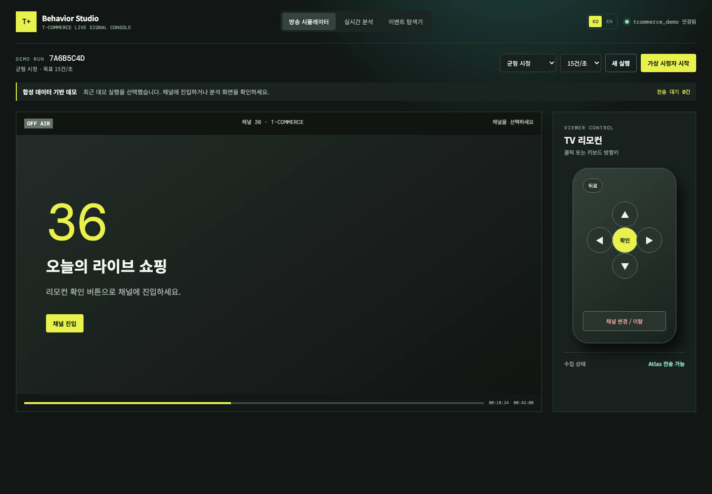
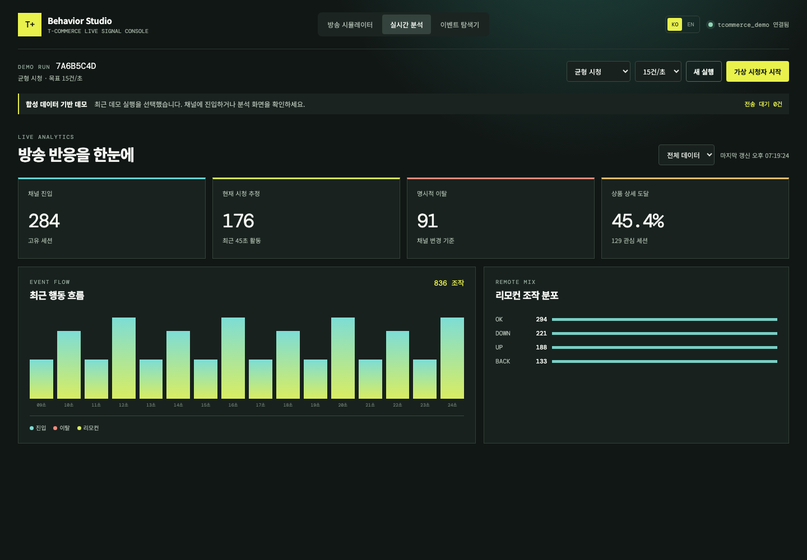
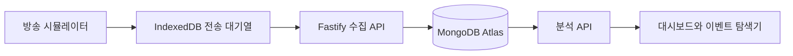

# T-Commerce 고객 행동 분석 데모

[English](README.md) | [한국어](README.ko.md)

TV 리모컨 조작과 채널 행동을 MongoDB Atlas에 저장하고, 실시간 지표와 시청 여정으로 확인하는 합성 데이터 기반 데모입니다.

기본 애플리케이션 페이지는 영어 `/` 또는 `/en`입니다. 화면의 `KO` 링크를 누르면 독립된 한국어 페이지 `/ko`로 이동합니다.

> 이 저장소는 기술 데모입니다. 특정 방송사나 쇼핑 채널과 관련이 없으며 실제 고객·결제·시청 데이터를 포함하지 않습니다.

## 화면

| 방송 시뮬레이터 | 실시간 분석 |
|---|---|
|  |  |

## 개요



채널 진입·이탈, 리모컨 입력, 화면 이동, 상품 상세 조회, 시청 Heartbeat를 이벤트로 기록합니다.

## 주요 기능

| 영역 | 기능 |
|---|---|
| 방송 시뮬레이터 | 채널 진입, 상품 탐색, 상세 보기, 뒤로 가기, 채널 이탈 |
| 언어별 페이지 | 영어 `/en`, 한국어 `/ko`, 상단 링크로 페이지 이동 |
| 이벤트 수집 | Fastify API에서 이벤트 스키마를 검증하고 Atlas에 저장 |
| 재시도 식별 | 클라이언트 UUID를 MongoDB `_id`로 사용해 재전송과 충돌 구분 |
| 브라우저 대기열 | IndexedDB에 미확정 이벤트를 보관하고 일시 장애 후 재전송 |
| 가상 시청자 | Web Worker에서 균형 시청·상품 탐색·조기 이탈 패턴 생성 |
| 실시간 분석 | 채널 진입, 명시적 이탈, 현재 시청 추정, 상품 상세 도달, 리모컨 분포 |
| 이벤트 탐색기 | 최근 원본 이벤트와 세션별 행동 순서 조회 |

## 기술 구성

- React 19, Vite, TypeScript
- Node.js, Fastify
- MongoDB Node.js Driver
- Zod 입력 검증
- IndexedDB 전송 대기열
- Web Worker 가상 이벤트 생성기
- Vitest

## 준비 사항

- Node.js 20 이상
- npm
- 별도의 MongoDB Atlas 데모 데이터베이스
- 데모 DB 읽기·쓰기와 인덱스 생성 권한을 가진 DB 사용자
- API 실행 환경에서 Atlas로 연결할 수 있는 네트워크 설정

## 실행 방법

1. 의존성을 설치합니다.

   ```bash
   npm install
   ```

2. 환경 파일을 만듭니다.

   ```bash
   cp .env.example .env
   ```

3. `.env`에 Atlas 연결 문자열을 설정합니다.

   ```dotenv
   MONGODB_URI=mongodb+srv://<username>:<password>@<cluster>/?retryWrites=true&w=majority
   MONGODB_DB=tcommerce_demo
   API_HOST=127.0.0.1
   API_PORT=3001
   EVENT_RETENTION_DAYS=7
   ```

4. 컬렉션 인덱스를 준비합니다.

   ```bash
   npm run setup
   ```

5. API와 웹 앱을 실행합니다.

   ```bash
   npm run dev
   ```

6. 언어별 페이지를 엽니다.

   ```text
   영어:   http://localhost:5173/en
   한국어: http://localhost:5173/ko
   기본:   http://localhost:5173
   ```

개발 환경에서는 Vite가 `/en`, `/ko` 요청을 SPA로 처리합니다. 운영 웹 호스팅에서도 두 경로를 `index.html`로 연결하는 Rewrite 설정이 필요합니다.

## 데모 순서

1. 상단에서 Atlas 연결 상태를 확인합니다.
2. **새 실행**을 선택합니다.
3. **방송 시뮬레이터**에서 채널 36에 진입합니다.
4. 리모컨 **확인**으로 상품 목록과 상품 상세 화면을 엽니다.
5. **채널 변경 / 이탈**로 명시적인 이탈 이벤트를 기록합니다.
6. **이벤트 탐색기**에서 이벤트를 선택해 세션 행동 순서를 확인합니다.
7. **실시간 분석**에서 갱신된 지표를 확인합니다.
8. 가상 시청자 시나리오와 속도를 선택해 집단 행동을 생성합니다.

## 이벤트 모델

```json
{
  "eventId": "client-generated-uuid",
  "schemaVersion": 1,
  "demoRunId": "run-uuid",
  "anonymousViewerId": "synthetic-12",
  "sessionId": "session-uuid",
  "sequence": 3,
  "channelId": "T-COMMERCE",
  "broadcastId": "tcommerce-live-001",
  "eventType": "remote_key",
  "remoteKey": "OK",
  "screenId": "catalog",
  "occurredAt": "2026-09-15T00:00:00.000Z",
  "playbackPositionMs": 123456,
  "source": "synthetic"
}
```

## API

| Method | 경로 | 용도 |
|---|---|---|
| `GET` | `/api/health` | API·MongoDB 연결 상태 확인 |
| `POST` | `/api/demo-runs` | 새 데모 실행 생성 |
| `PATCH` | `/api/demo-runs/:id` | 시나리오·속도·상태 변경 |
| `GET` | `/api/demo-runs` | 최근 데모 실행 목록 |
| `POST` | `/api/events/batch` | 최대 100개 이벤트 검증·수집 |
| `GET` | `/api/analytics/summary` | 실행별 요약 지표 계산 |
| `GET` | `/api/events` | 최근 원본 이벤트 조회 |
| `GET` | `/api/sessions/:id/events` | 세션 행동을 순서대로 조회 |

## 수집 신뢰성

- 이벤트를 전송하기 전에 IndexedDB에 저장합니다.
- 재전송 시 기존 이벤트 ID와 순서 번호를 유지합니다.
- MongoDB `_id`에 이벤트 ID를 사용합니다.
- 저장·중복·충돌·유효성 오류·재시도 가능 결과를 구분합니다.
- 저장 확인 또는 영구 거부가 확인된 이벤트만 브라우저 대기열에서 제거합니다.
- 이벤트 저장에 `writeConcern: "majority"`를 사용합니다.

이는 재전송에 안전한 수집 흐름을 보여주는 것이며 종단 간 Exactly Once를 보장하지는 않습니다.

## 검증

```bash
npm test
npm run typecheck
npm run build
npm audit
```

## 현재 범위와 제한사항

- 방송·상품·시청자·이벤트는 모두 합성 데이터입니다.
- 실제 셋톱박스, 주문·결제, CRM, 운영 Oracle과 연결하지 않습니다.
- 가상 생성 속도는 행동 단계 빈도이며 공인된 초당 이벤트 처리 성능이 아닙니다.
- 현재 API는 Atlas에 직접 저장하며 서버 메시지 큐와 영속 DLQ가 없습니다.
- 분석은 선택한 실행의 원본 이벤트를 읽습니다. 운영 규모에서는 조회 기간 제한과 집계 컬렉션이 필요합니다.
- 개발 API에는 운영용 인증·인가가 없습니다.
- 유효하지 않거나 충돌한 이벤트는 결과를 표시한 뒤 브라우저 대기열에서 제거됩니다. 운영 시스템에는 영속 격리 저장소가 필요합니다.

## 보안

- `MONGODB_URI`를 `VITE_` 환경변수로 노출하지 않습니다.
- `.env`와 인증정보를 Git에 커밋하지 않습니다.
- 별도의 데모 프로젝트·DB와 최소 권한 사용자를 사용합니다.
- API 실행 환경에서만 Atlas 네트워크 접근을 허용합니다.
- 외부 배포 전에 인증·인가·Rate Limit·엄격한 CORS를 추가합니다.
- 실제 고객 식별자나 운영 방송 자료를 사용하지 않습니다.

## 저장소 구조

```text
src/
  api/       Fastify API와 MongoDB 접근
  shared/    이벤트 계약과 분석 로직
  web/       React UI, 번역, 전송 대기열, 가상 이벤트 Worker
scripts/
  setup-demo.ts
screenshots/
```

## 라이선스

현재 오픈소스 라이선스가 포함되어 있지 않습니다. 별도의 라이선스가 추가되기 전에는 관련 법률이 허용하는 범위를 제외하고 복제·수정·재배포 권한이 부여되지 않습니다.
