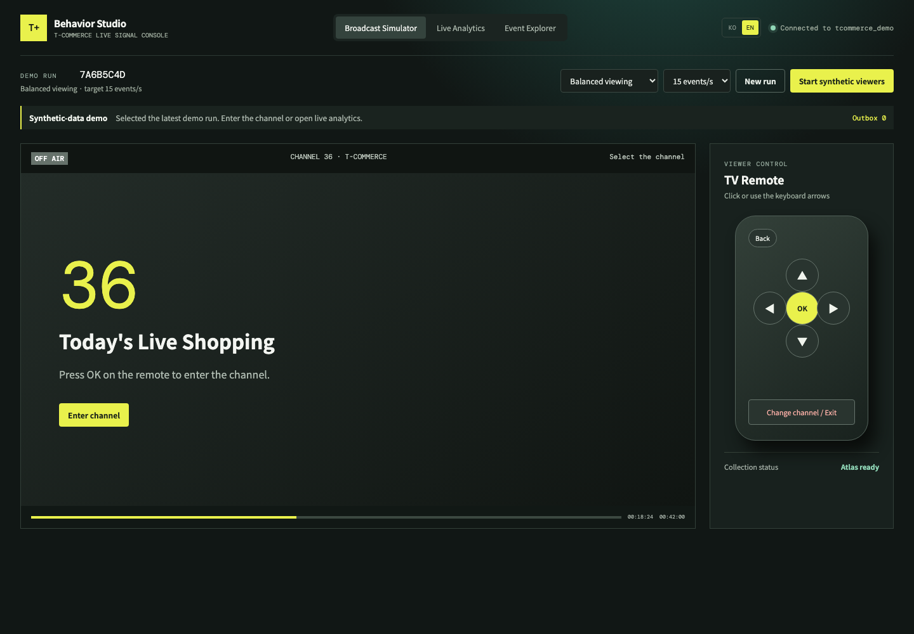
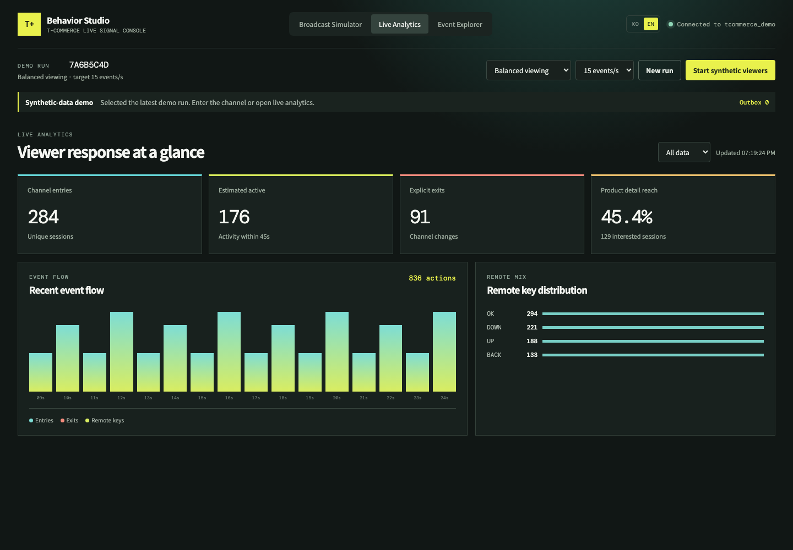
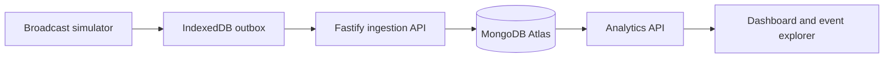

# T-Commerce Behavior Studio

[English](README.md) | [한국어](README.ko.md)

A synthetic-data demo that captures TV remote-control actions and channel behavior in MongoDB Atlas, then presents live analytics and session journeys.

English is the default application page at `/` and `/en`. The `KO` link navigates to the dedicated Korean page at `/ko`.

> This repository is a technology demonstration. It is not affiliated with a broadcaster or shopping channel, and it does not contain real customer, payment, or viewing data.

## Screenshots

| Broadcast Simulator | Live Analytics |
|---|---|
|  |  |

## Overview



The app simulates a TV shopping channel and records channel entry, channel exit, remote-key input, screen navigation, product-detail views, and viewer heartbeats.

## Features

| Area | Capability |
|---|---|
| Broadcast simulator | Enter a channel, navigate products, open product details, go back, and change channels |
| Language pages | English at `/en`, Korean at `/ko`, with navigation links between them |
| Event ingestion | Validate and store event documents through a Fastify API |
| Retry-safe identity | Use a client-generated UUID as the MongoDB `_id` to detect retries and conflicts |
| Browser outbox | Keep unconfirmed events in IndexedDB and retry them after temporary failures |
| Synthetic viewers | Generate balanced, product-exploration, and early-exit behavior in a Web Worker |
| Live analytics | Show entries, explicit exits, estimated active sessions, product reach, and remote-key distribution |
| Event explorer | Inspect recent raw events and reconstruct a session by sequence number |

## Technology

- React 19, Vite, and TypeScript
- Node.js and Fastify
- MongoDB Node.js Driver
- Zod validation
- IndexedDB outbox
- Web Worker synthetic-event generator
- Vitest

## Prerequisites

- Node.js 20 or later
- npm
- A dedicated MongoDB Atlas demo database
- A database user allowed to create indexes and read/write the demo database
- Network access from the API host to Atlas

## Quick Start

1. Install dependencies.

   ```bash
   npm install
   ```

2. Create a local environment file.

   ```bash
   cp .env.example .env
   ```

3. Set the Atlas connection string in `.env`.

   ```dotenv
   MONGODB_URI=mongodb+srv://<username>:<password>@<cluster>/?retryWrites=true&w=majority
   MONGODB_DB=tcommerce_demo
   API_HOST=127.0.0.1
   API_PORT=3001
   EVENT_RETENTION_DAYS=7
   ```

4. Create the demo indexes.

   ```bash
   npm run setup
   ```

5. Start the API and web application.

   ```bash
   npm run dev
   ```

6. Open an application page.

   ```text
   English: http://localhost:5173/en
   Korean:  http://localhost:5173/ko
   Default: http://localhost:5173
   ```

Vite provides the SPA fallback for `/en` and `/ko` in development. A production web host must also rewrite these routes to `index.html`.

## Demo Walkthrough

1. Confirm that the header shows an active Atlas connection.
2. Select **New run**.
3. Open the **Broadcast Simulator** and enter channel 36.
4. Press **OK** to open the product list and press **OK** again to open product details.
5. Select **Change channel / Exit** to record an explicit exit.
6. Open **Event Explorer** and select an event to inspect its session journey.
7. Open **Live Analytics** to view the updated metrics.
8. Select a synthetic scenario and start the viewer generator for aggregate behavior.

## Event Model

```json
{
  "eventId": "client-generated-uuid",
  "schemaVersion": 1,
  "demoRunId": "run-uuid",
  "anonymousViewerId": "synthetic-12",
  "sessionId": "session-uuid",
  "sequence": 3,
  "channelId": "T-COMMERCE",
  "broadcastId": "tcommerce-live-001",
  "eventType": "remote_key",
  "remoteKey": "OK",
  "screenId": "catalog",
  "occurredAt": "2026-09-15T00:00:00.000Z",
  "playbackPositionMs": 123456,
  "source": "synthetic"
}
```

## API

| Method | Path | Purpose |
|---|---|---|
| `GET` | `/api/health` | Check API and MongoDB connectivity |
| `POST` | `/api/demo-runs` | Create a synthetic demo run |
| `PATCH` | `/api/demo-runs/:id` | Update scenario, rate, or status |
| `GET` | `/api/demo-runs` | List recent demo runs |
| `POST` | `/api/events/batch` | Validate and ingest up to 100 events |
| `GET` | `/api/analytics/summary` | Calculate summary metrics for a run |
| `GET` | `/api/events` | List recent raw events |
| `GET` | `/api/sessions/:id/events` | Return a session journey in sequence order |

## Reliability Semantics

- Events are written to IndexedDB before transmission.
- Retries keep the original event ID and sequence number.
- MongoDB `_id` is the event ID.
- The API distinguishes stored, duplicate, conflicting, invalid, and retryable outcomes.
- Only confirmed or permanently rejected events leave the browser outbox.
- `writeConcern: "majority"` is used for event writes.

These mechanisms demonstrate retry-safe ingestion, not end-to-end exactly-once delivery.

## Validation

```bash
npm test
npm run typecheck
npm run build
npm audit
```

## Current Scope and Limitations

- The broadcast, products, viewers, and events are synthetic.
- This is not integrated with a set-top box, order system, payment system, CRM, or production Oracle database.
- The synthetic rate controls behavior-generation steps; it is not a certified events-per-second benchmark.
- The demo writes directly through the API to Atlas. It does not include a server-side message queue or durable DLQ.
- Analytics currently reads the source events for the selected run. Production-scale deployments should use bounded queries and materialized summaries.
- The development API has no production authentication or authorization layer.
- A failed or conflicting browser event is removed from the outbox after being reported; a production system should persist it in a durable quarantine store.

## Security

- Never expose `MONGODB_URI` through a `VITE_` environment variable.
- Never commit `.env` files or credentials.
- Use a dedicated demo project, database, and least-privilege database user.
- Restrict Atlas network access to the API environment.
- Add authentication, authorization, rate limits, and strict CORS before any shared deployment.
- Do not use real customer identifiers or production broadcast assets.

## Repository Layout

```text
src/
  api/       Fastify API and MongoDB access
  shared/    Event contracts and analytics logic
  web/       React UI, translations, outbox, and synthetic worker
scripts/
  setup-demo.ts
screenshots/
```

## License

No open-source license is included. Unless a license is added, no permission is granted to copy, modify, or redistribute this repository beyond rights provided by applicable law.
